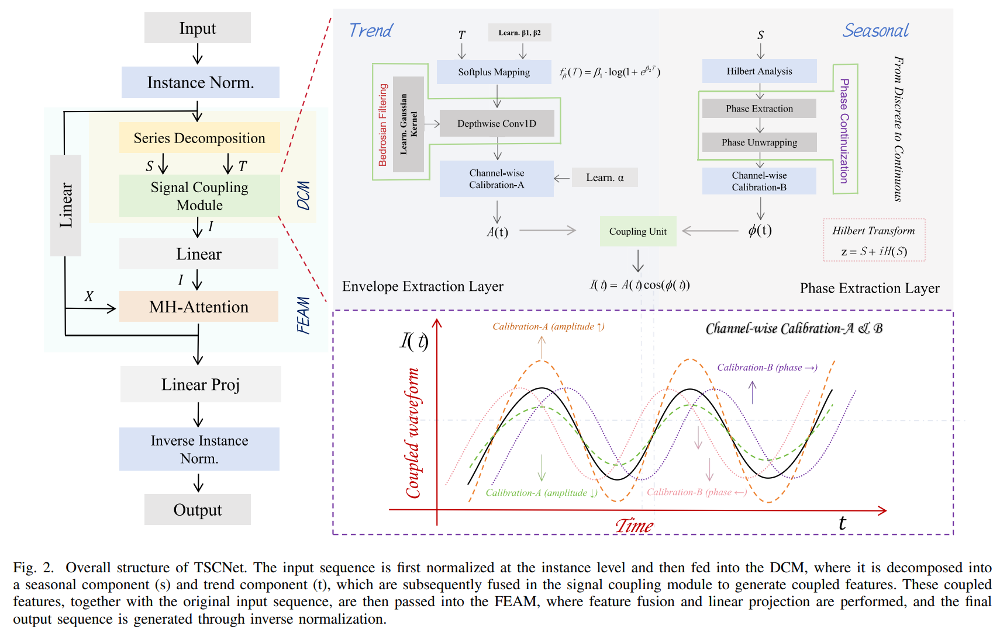

# TSCNet

This repository is the official implementation of the paper **TSCNet: A Trend–Seasonality Coupled Network for Efficient Multivariate Time Series Forecasting**.

📄 This paper has been accepted by **IEEE Transactions on Neural Networks and Learning Systems (IEEE TNNLS)**.
🔗 Paper: [https://ieeexplore.ieee.org/abstract/document/11698844]

## Method Overview

**Motivation**: Multivariate time series usually contain both long-term trends and periodic seasonal fluctuations. Existing methods tend to be structurally complex and computationally expensive, and they often model the trend and seasonal components independently, ignoring the interaction between them.

**Key idea**: TSCNet **couples** trend and seasonality and models them jointly, allowing the two components to interact within a lightweight network instead of being handled separately. This captures the relationship between trend and periodicity while keeping the parameter count small and inference fast, balancing accuracy and efficiency.

**Highlights**:
- **Trend–seasonality coupling**: jointly models the trend and seasonal components and their interaction;
- **Lightweight design**: few parameters and fast inference, suitable for efficiency-sensitive scenarios;
- **Strong performance**: outperforms mainstream baselines on public benchmarks including ETT, Weather, Electricity, and Traffic.



## Repository Contents

This repository provides the model code, experimental configurations, and model checkpoints. The directory structure is as follows:

| Directory | Description |
| --- | --- |
| `models/` | Model implementation |
| `layers/` | Model components |
| `data_provider/` | Data loading and processing |
| `exp/` | Experiment running code |
| `utils/` | Utility functions |
| `Configs/` | Experimental configuration files |
| `checkpoints/` | Model checkpoints |

## Configurations

The `Configs/` directory provides the experimental configurations for different loss functions:

- `Configs/HL_loss.png`: configurations for the HL loss;
- `Configs/MSE_loss.png`: configurations for the MSE loss.

## Checkpoints

The `checkpoints/` directory provides model checkpoints trained with different loss functions:

- `checkpoints/HL_loss/`
- `checkpoints/L1_loss/`
- `checkpoints/MSE_loss/`

These checkpoints can be used for direct evaluation or for reproducing the experimental results reported in the paper.

## Citation

If you find this repository useful for your research, please consider citing our paper:

```bibtex
@ARTICLE{11698844,
  author={Li, Ziqiong and Chai, Heyu and Liu, Xinru and Liu, Shengjun},
  journal={IEEE Transactions on Neural Networks and Learning Systems}, 
  title={TSCNet: A Trend–Seasonality Coupled Network for Efficient Multivariate Time Series Forecasting}, 
  year={2026},
  volume={},
  number={},
  pages={1-14},
  keywords={Modeling;Forecasting;Timing;Joining processes;Frequency;Sequences;Sequential analysis;Couplings;Low-pass filters;Transforms;Attention;frequency;Hilbert;phase;time series forecasting},
  doi={10.1109/TNNLS.2026.3729311}}
```

## Contact

If you have any questions, please contact Ziqiong Li from the School of Mathematics and Statistics, Central South University, at qionglouyuyu@csu.edu.cn.
